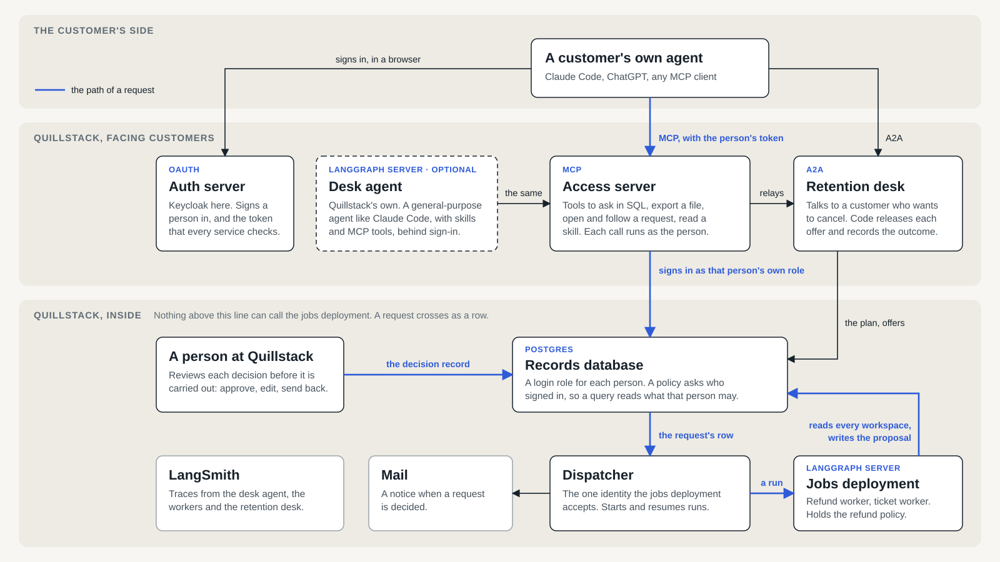

# frontdesk

A customer's records and requests at a company, served to an agent. The company here is Quillstack, a made-up
subscription product. The agent is the customer's own, connected over MCP, or the desk agent in this repository
for a customer who brings none.

The idea it tests: a company does not have to be the intelligence its customers talk to. It can be the records,
the rules for who may read them, and the processes that need its authority, and let any agent stand in front.

## What is in it



The blue line is the path of a request: a customer's agent opens it through the access server, it is written as a
row by the customer's own database role, the dispatcher hands it to a worker, a person reviews what the worker
proposes, and the result goes back into the row.

| Part | Where | What it does |
|---|---|---|
| Records and access rules | `src/frontdesk/db/` | The tables, one Postgres login role for each person, and the policies that decide which rows a role reads. |
| Access server | `src/frontdesk/access/` | Eleven MCP tools: who am I, list tables, run SQL, export CSV, open a request, read requests, answer a question, read notices, talk to the retention desk, read a skill. Each runs as the caller. |
| Skills | `src/frontdesk/skills/` | What any agent needs to know to use the tools well. Served over MCP, and loaded by the desk agent as deep agent skills. |
| Desk agent | `src/frontdesk/desk/` | Quillstack's own conversational agent: a deep agent with the access server's tools, the skills, notes about each person, a gate on each message, and a memory turn. |
| Jobs | `src/frontdesk/jobs/` | The refund worker (refundo's structured agent, as it was measured, with a person's review and the refund itself) and the ticket worker. The policy lives here and nowhere a customer's message reaches. |
| Dispatcher | `src/frontdesk/dispatcher.py` | Turns request rows into worker runs, resumes them, starts failed ones again, mails notices. |
| Retention desk | `src/frontdesk/retention/` | An A2A agent at http://localhost:18200 that makes offers to a customer who wants to cancel. Code releases each offer, one at a time; the model cannot make one up and does not know the last one. `scripts/negotiate.py` plays a customer's agent against it. |
| Cluster | `deploy/`, `Makefile` | Everything on k3s: Postgres, two Redis, Keycloak, a mail catcher, and the services above, with network rules between them. |

## Run it

It needs colima, Docker, kubectl and uv, and a `.env` with `LANGSMITH_API_KEY`, `ANTHROPIC_API_KEY`,
`OPENAI_API_KEY` and `FIREWORKS_API_KEY`.

```
make up        # the cluster, its secrets, the database, three images, every service
make status    # what runs, and where
make seed      # the demo records again, with every time counted from now
```

The cluster is a colima profile of its own, `frontdesk`. `make up` does not switch your Docker or kubectl context.

Three ways in:

```
uv run --env-file .env frontdesk chat dana       # the desk agent, signed in as dana
scripts/their-agent.sh                           # Claude Code as a customer's own agent, with Quillstack's tools only
uv run --env-file .env frontdesk review lena     # Quillstack's reviewer: decide what the workers proposed
```

### Connect an agent of your own

The access server is an OAuth resource server, and Keycloak signs people in. To connect Claude Code as it is, with
its own tools beside Quillstack's:

```
claude mcp add --transport http quillstack http://localhost:18000/mcp --client-id frontdesk-cli --callback-port 18765
```

In Claude Code, `/mcp`, then `quillstack`, then Authenticate opens Keycloak's sign-in page in the browser. Sign in
as one of the demo people below. The same entry in a `.mcp.json` file:

```json
{"mcpServers": {"quillstack": {"type": "http", "url": "http://localhost:18000/mcp",
                               "oauth": {"clientId": "frontdesk-cli", "callbackPort": 18765}}}}
```

`scripts/their-agent.sh` starts Claude Code with that entry and nothing else: no built-in tools, no skills, no
settings of yours. `scripts/their-agent.sh --as dana` skips the browser and signs in as dana with the demo password.

Mail that Quillstack sends is at http://localhost:18025. `uv run --env-file .env frontdesk requests` lists every
request and where it stands.

## The demo people

Every person signs in with the demo password in `.env` (`DEMO_PASSWORD`).

| Workspace | Plan | People | A refund request on it |
|---|---|---|---|
| Acme Design | Team, monthly, $80 | dana (owner), priya (billing admin), marcus, tom (members) | Renewed 3 days ago and unused since: refunded in full. |
| Birch Analytics | Business, annual, $2,000 | elena (owner), farid (billing admin), grace, hugo, ines (members) | Renewed 10 days ago and in use: a credit over $500, so a person decides. |
| Cobalt Labs | Starter, monthly, $20 | kenji (owner), lola (member) | Renewed 12 days ago and in use: denied. |

The answers hold for a few days after a seed, because the records age. `make seed` makes them fresh.

What each role reads:

| | Own tickets and activity | The workspace's billing | Activity as daily totals | Everyone's tickets and activity |
|---|---|---|---|---|
| member | yes | no | no | no |
| billing admin | yes | yes | yes | no |
| owner | yes | yes | yes | yes |

## Who holds what

The design rests on what each part is able to do, and not on what an agent was told.

- A customer's agent holds the customer's token. With it the access server signs in to Postgres as that person's
  own role. A policy asks for `session_user`, which SQL cannot change, so a query a model wrote reads what the
  person may read.
- The access server holds the key that derives a customer's database password, and no role of its own. It cannot
  read a workspace or decide a request.
- The desk agent holds model keys and its own state database. It holds no password for the records and no
  identity the jobs deployment accepts. The cluster gives it no route to the jobs deployment.
- A request reaches a worker as a row that the customer's own role wrote. The dispatcher is the one process that
  holds the identity the jobs deployment accepts.
- A worker reads every workspace and holds the policy. What a customer sees of its work is three fields a person
  approved: the outcome, the amount and a note.

`scripts/cluster_secrets.py` is the list of which secret each deployment gets. `deploy/apps/network.yaml` is the
list of who may reach whom.

## Tests

```
make test
```

- `tests/test_access_rules.py` signs in to the database as each person and checks what they read, what they
  cannot, and that SQL cannot make a session someone else's.
- `tests/test_refund_tools.py` compares the refund worker's prompt, policy and tools with refundo's source.
- `tests/test_refund_worker.py` runs the worker's steps around a stand-in for the agent: each of the reviewer's
  choices, and what the customer and the records hold afterwards.
- `tests/test_ledger.py` and `tests/test_retention_ladder.py` check the writes behind requests and offers.

The tests need the cluster's Postgres and a seed. They call no model.

## What is not built

- A customer's agent registers with Keycloak ahead of time, as the client `frontdesk-cli`. An agent that registers
  itself when it first connects is not set up.
- The chat and the review are command lines. There is no web page for either.
- A reviewer is whoever names themselves on the command line. The realm has reviewer accounts, and nothing checks
  them yet.
- Nothing is evaluated. Each part was run on a handful of inputs.

## Where things come from

The refund policy, the case file and the worker's prompt are refundo's, which measured them.

- `docs/decisions.md`: the decisions that give this its shape, each with what it costs and whose it is.
- `docs/open-questions.md`: what the design leaves undecided.
- `docs/friction.md`: what was rough in LangGraph Server, deepagents, LangChain, FastMCP and Claude Code while
  this was built, with how each point is known.
