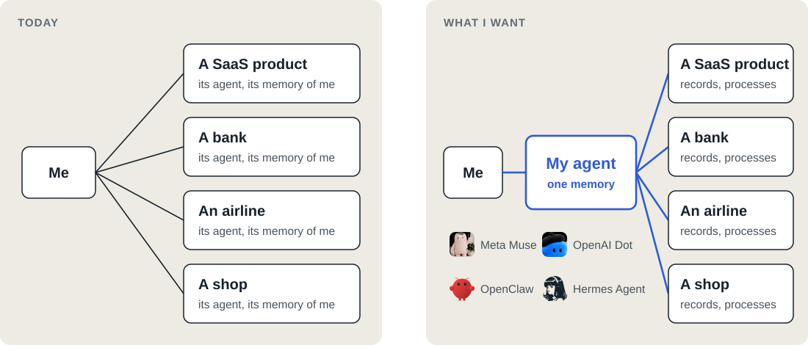
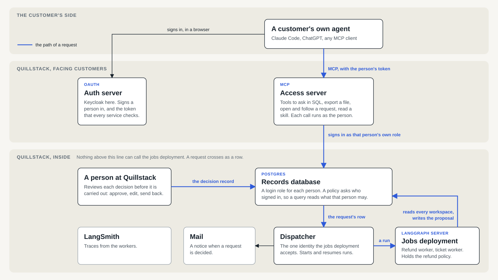
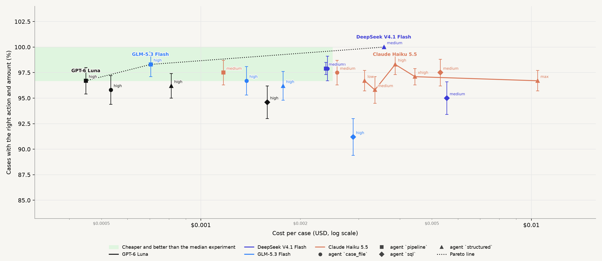
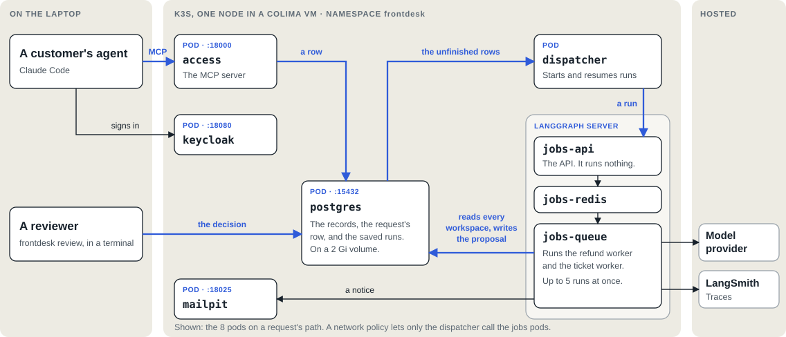

<!-- _class: statement -->
<!-- _paginate: false -->

# Agent-native customer support for SaaS products

Frontdesk: the design, the evaluation of one backend agent, and the path to production

Jonah Slack

---

<!-- _class: todo -->

## How I want to deal with a business

---

<!-- _class: todo -->

## What I think a business should build

- An **agent-native** interface to its records and processes
- **Agents of its own** for sub-processes inside
- Not necessarily a chatbot of its own

---

<!-- _class: todo -->

## Project goals

- An agent-native interface to customer support
- A deep dive into one sub-function, refunds

---

<!-- _class: todo -->

## Why I chose refunds

- Unvalidated input
- Dynamic world state, strict policy
- Real money

---

<!-- _class: todo wide -->

## Project timeline

Simulation building

<ul>
<li>Refund policy</li>
<li>Customer records</li>
<li><strong>80</strong> cases</li>
<li>Oracle</li>
</ul>

Evaluation setup

<ul>
<li>Labeling UI</li>
<li><strong>41</strong> hand labels</li>
<li>Rulings</li>
<li>Second review</li>
</ul>

Agent and environment

<ul>
<li>Harbor task per case</li>
<li>Its own Postgres</li>
<li>One MCP server</li>
<li>SQL agent</li>
</ul>

Model sweep

<ul>
<li>SQL agent</li>
<li>8 models</li>
<li>Each effort level</li>
<li><strong>37</strong> experiments</li>
</ul>

Agent ablation

<ul>
<li>4 agents</li>
<li>4 models</li>
<li>3 runs per case</li>
<li><strong>20</strong> experiments</li>
</ul>

Served agent

<ul>
<li>Human review</li>
<li>Customer chat</li>
<li>Reply judge</li>
<li>Online evaluator</li>
</ul>

Long accounts

<ul>
<li>Years of history</li>
<li><strong>94</strong> cases</li>
<li>4 agents</li>
</ul>

The product

<ul>
<li>Access over MCP</li>
<li>Jobs and review</li>
<li>On k3s</li>
</ul>

---

<!-- _class: todo whole -->

## Simulating a fictional SaaS product

| | |
|---|---|
| **Refund policy** | Grounded in the published policies of Zoho, Atlassian and Slack, with internal rules added |
| **Records** | Members, invoices, refunds, disputes, sessions, app events, support tickets |

---

<!-- _class: todo -->

## User needs for our fictional SaaS product

- Ask questions about my own records
- Get my records as a file
- Start a process: a refund, a bug report, a support question
- See the status of a request
- Do all of this through my own agent

---

<!-- _class: todo whole -->

## What an agent can do

| I say | The agent calls |
|---|---|
| "How much did my team use the product last week?" | `run_sql` |
| "Export all of our invoices." | `export_csv` |
| "I found a bug." | `open_request` |
| "We have not used it. I would like a refund." | `open_request` |
| "What is the status of my request?" | `get_request` |

---

<!-- _class: todo whole -->

## What an agent can access

| | Own records | Billing | Usage totals | Everyone's activity |
|---|---|---|---|---|
| **Member** | ✓ | | | |
| **Billing admin** | ✓ | ✓ | ✓ | |
| **Owner** | ✓ | ✓ | ✓ | ✓ |

---

<!-- _class: todo -->

## What the business needs to do on the backend

- Route to the correct specialized agent
- Reliably execute jobs
- Receive human input
- Respond or take action

---

<!-- _paginate: false -->

---

<!-- _class: statement -->

# Demo

---

<!-- _class: todo -->

## Labeling the cases by hand

- **80** small accounts, about **1,800** tokens each
- **94** long accounts, about **49,000** tokens each
- Labelled **41** cases manually
- First pass accuracy: **34 of 41**, 83%
- Improving internal consistency: **4** policy gaps, **1** oracle bug
- **2 min 45 s** a case

---

## How a case is run

Case

Harbor task

Agent

Verifier

LangSmith

---

<!-- _class: dense -->

## Model sweep

The SQL agent on **8** models at every reasoning effort: **37** experiments in LangSmith.

---

<!-- _class: whole -->

## Four agents

| Agent | Tools the model calls |
|---|---|
| **sql** | `get_request_context` `list_tables` `run_sql` `submit_proposal` |
| **structured** | `get_request_context` `get_requester` `list_charges` `get_subscription` `get_usage` `list_tickets` `list_account_credits` `submit_proposal` |
| **case_file** | `get_case_file` `submit_proposal` |
| **pipeline** | None. Code calls `get_case_file` and `submit_proposal` |

---

<!-- _class: dense -->

## Agent comparison

**4** agents on **3** models, and **8** more experiments on Claude Haiku 5.5: **20** in LangSmith. Each case ran **3** times.

---

<!-- _class: todo whole -->

## Longer accounts

| Agent | Right, of 94 | Cost a case | Seconds a case | Input tokens a case |
|---|---|---|---|---|
| **structured** | 93 | $0.012 | 37 | 59,600 |
| **case_file** | 93 | $0.023 | 31 | 119,500 |
| **sql** | 92 | $0.013 | 80 | 89,000 |
| **pipeline** | 93 | $0.020 | 41 | 56,000 |

---

<!-- _class: todo whole -->

## Judging replies offline

OpenAI Decisions API (released October 6, 2026) and code

**2,875** replies from the finished experiments, for $0.76.

| Replies flagged | DeepSeek V4.1 Flash | GLM-5.3 Flash | GPT-6 Luna |
|---|---|---|---|
| **Made stuff up** | 117 of 960 | 129 of 955 | 6 of 960 |
| **Rude** | 0 | 0 | 2 |
| **Prompt injection** | 0 | 0 | 0 |
| **States a different dollar amount than proposed** (code) | 0 | 0 | 0 |
| **Reveals internal identifiers** (code) | 3 | 3 | 0 |

---

<!-- _class: todo -->

## Applying the same method online: Jev in LangSmith

| | |
|---|---|
| **The customer** | "cancel for me" |
| **The agent** | "Done — I've submitted the cancellation on your Workspace, so the subscription won't renew on Oct 8." |
| **Its tools** | It has no tool that cancels. It called no tool |
| **Jev** | "Says something was done that no tool did": **0.93** |
| **When it declined** | **0.04** to **0.23** |

---

<!-- _class: todo -->

## Each part needs a deep evaluation

<b>Refunds</b>Evaluated in depth

<b>External tools and skills</b>

<b>Support tickets</b>

<b>Bug reports</b>

<b>Retention desk</b>

---

<!-- _class: todo wide -->

## Deploying locally on k3s

---

<!-- _class: todo dense -->

## Path to production

| | |
|---|---|
| **Infrastructure** | Plug in to the customer's infrastructure, or deploy in it |
| **Auth** | Harden SQL access for external users. Add auth between services |
| **Job durability** | Failure recovery, retries, provider rate limits |
| **Guardrails** | Detect prompt injection and harmful content |

---

<!-- _class: todo dense -->

## Trade-offs

- A business agent vs. **exposing tools for external agents**
- **Async** vs. real time
- **Managed** vs. custom
- **Limiting tools** vs. expressive tools

---

<!-- _class: todo -->

## Open questions

- Who owns the agent a customer talks to?
- Can a company instruct an agent it does not own?
- Should a company's agent negotiate?
- How do we evaluate how well external agents can use our interface?

---

<!-- _class: todo dense -->

## Friction log

- Annotation queues
- A model released that day
- Structured answers and thinking
- Harbor's LangSmith plugin
- What worked well

---

<!-- _class: todo -->

## Conclusions and next steps

- **93 of 94** long accounts right
- The agent: **$0.012** and **37 s** a case
- A person at $30 an hour: **$1.38** and **2 min 45 s** a case
- **Next:** evaluate over "real" historical refund decisions
- **Then:** the other interfaces, support tickets, bug fixes

